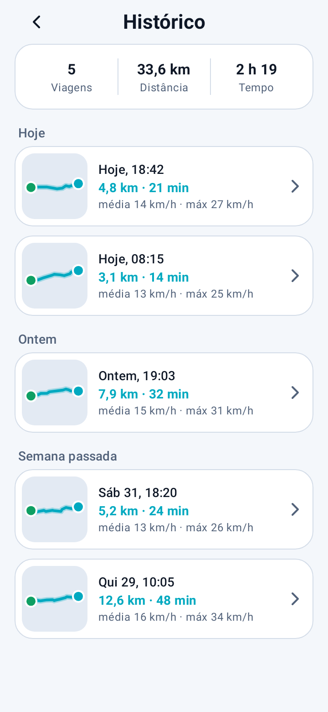
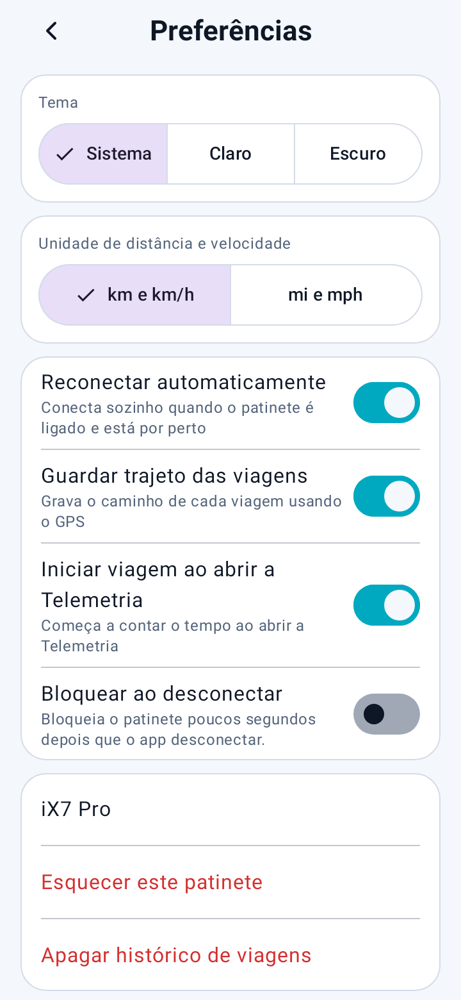
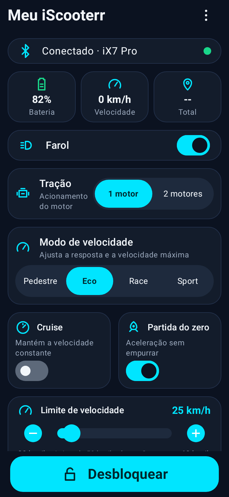
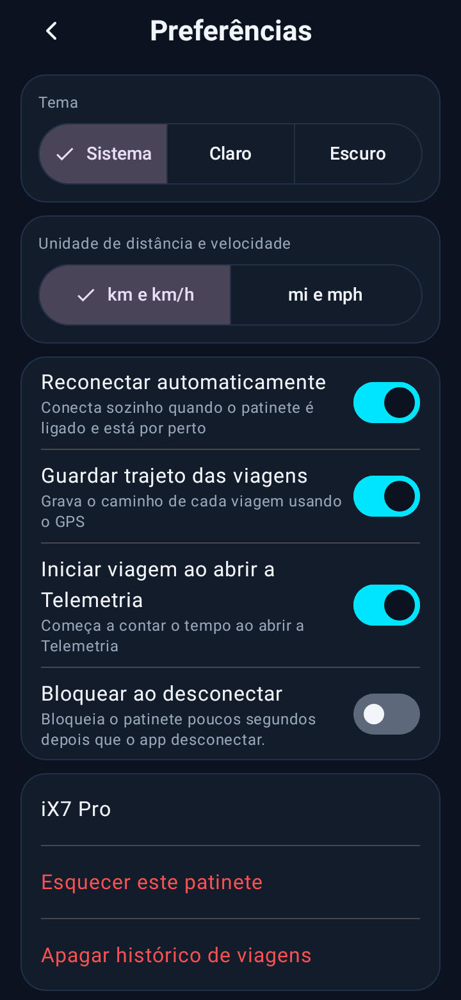

# Meu iScooter

Aplicativo Android independente para controlar e acompanhar o seu patinete elétrico iScooter pelo celular: bloqueio e desbloqueio, telemetria em tempo real e histórico de viagens com trajeto no mapa.

<table>
  <tr>
    <td align="center"> Início</td>
    <td align="center"> Bloqueado</td>
    <td align="center"> Telemetria</td>
    <td align="center"> Histórico</td>
    <td align="center"> Viagem</td>
    <td align="center"> Preferências</td>
  </tr>
  <tr>
    <td align="center"></td>
    <td align="center"></td>
    <td align="center"></td>
    <td align="center"></td>
    <td align="center"></td>
    <td align="center"></td>
  </tr>
</table>

---

## Recursos

- **Tela inicial objetiva:** bloqueio e desbloqueio em um toque, farol, 1 ou 2 motores, modo de velocidade (Eco, Drive ou Sport), cruise, partida do zero e limite de velocidade.
- **Bloqueio confiável:** o app só mostra "Bloqueado" depois que o patinete confirma. Se ele não responder, o app avisa e você tenta de novo.
- **Telemetria em tempo real:** velocidade, bateria, consumo, corrente, tensão e temperaturas.
- **Histórico de viagens:** duração, distância, velocidade média e máxima, com o trajeto no mapa e a altimetria (via GPS do celular).
- **Backup e restauração:** viagens, patinete, PIN e preferências em um único arquivo protegido por senha.
- **Temas claro e escuro.**
- **Software livre:** licença MIT, código aberto para conferir e melhorar.

Este projeto é uma **alternativa independente** ao aplicativo oficial da iScooter, pensada para quem quer um app simples e transparente. O app oficial pode continuar instalado; use um de cada vez enquanto conecta.

---

## Instalação

1. **Baixe o arquivo de instalação (`.apk`)** na página de versões do projeto.
2. **Abra o arquivo** no celular e, se pedido, permita "instalar apps desta fonte".
3. Toque em **Instalar**.
4. **Abra o app** e permita o uso de **Bluetooth** e de **dispositivos próximos**.
5. **Ligue o patinete**, chegue perto dele, toque em **Procurar** e escolha o **seu** patinete.

A busca só precisa ser feita na primeira vez. Se o patinete desligar sozinho depois de alguns minutos parado, o app reconecta quando ele for ligado de novo.

> **Dica:** o GPS não funciona com a tela apagada se o modo **Economia de energia** do Android estiver ligado. Para gravar o trajeto da viagem, deixe-o desligado.

---

## Cuidados e avisos

- Use **somente no seu próprio patinete**.
- **Não use o celular enquanto estiver andando.** Olhe sempre a rua.
- O app **não burla antifurto** nem qualquer proteção de terceiros.
- Projeto **independente**, sem ligação com a marca iScooter nem com o aplicativo oficial. As marcas pertencem aos seus donos.
- Uso **por sua conta e risco**, sem garantia de funcionamento.

---

## Contribuir

Contribuições são bem-vindas:

- **Testar** o app e relatar como foi a experiência.
- **Sugerir** melhorias.
- **Avisar** quando algo não funcionar como esperado.
- **Melhorar o código** do projeto.

A documentação técnica fica em [`docs/`](docs/) (decisões em `docs/adr/`, processo de CI em `docs/process/ci.md`).

---

## Licença

Distribuído sob a **Licença MIT**: você pode usar, copiar, modificar e distribuir, mantendo o aviso de autoria. Texto completo em [LICENSE](LICENSE).
