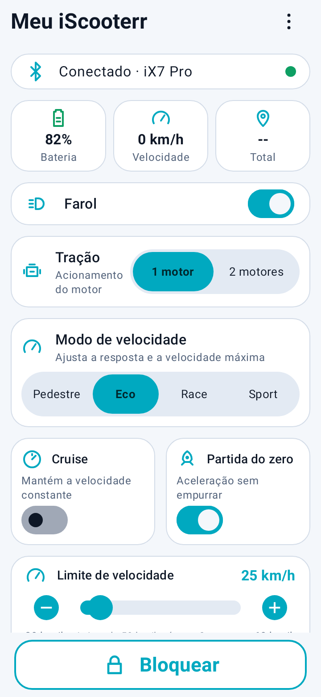
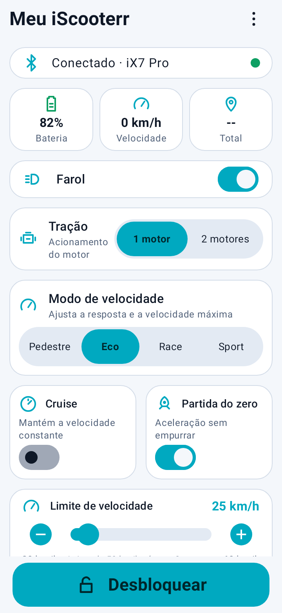
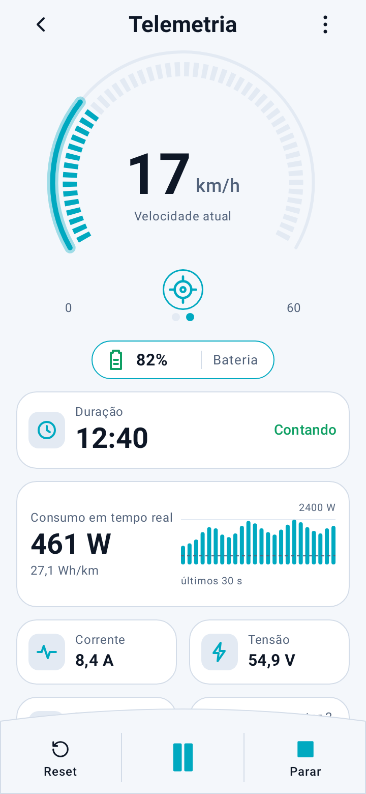
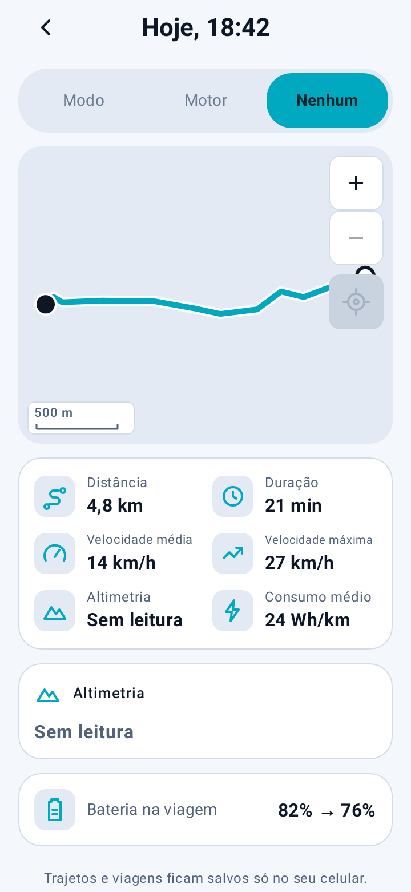
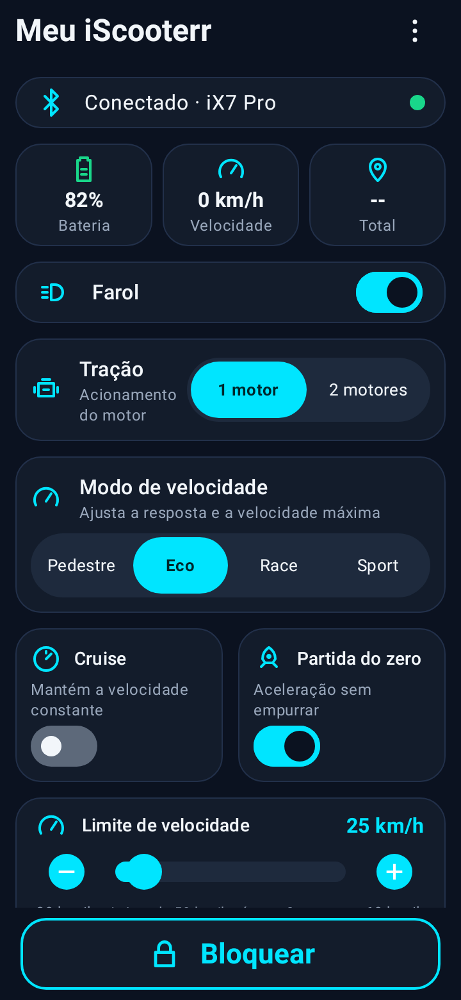
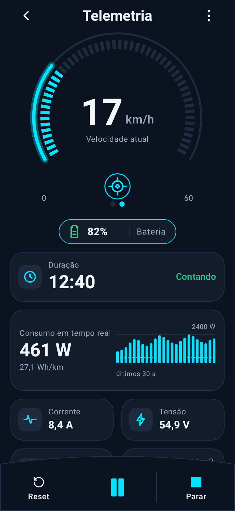
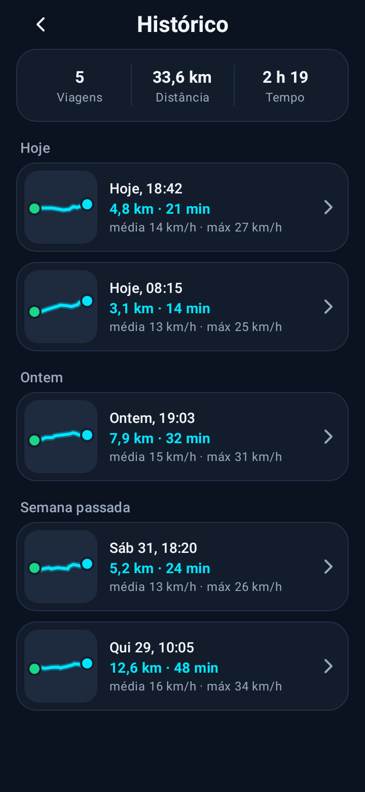
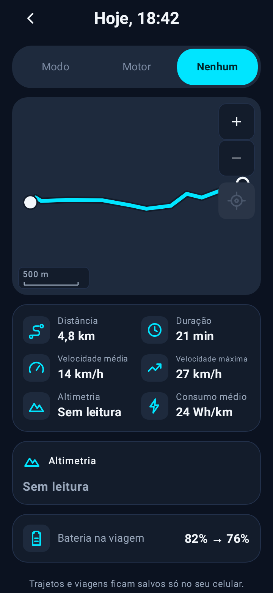

# Meu iScooter

Um aplicativo Android simples para controlar o seu patinete elétrico iScooter pelo celular.

---

## ⚠️ Situação atual

**O app está em fase de testes.** Ele já conecta ao patinete, bloqueia e desbloqueia, mostra a telemetria em tempo real e guarda o histórico de viagens com o trajeto no mapa. Ainda não há uma versão pública para baixar: as versões de teste são geradas pelo projeto (veja `docs/process/ci.md`).

---

## Telas do aplicativo

Imagens reais geradas pelo próprio app (tema claro). Role a linha para o lado em telas pequenas.

<table>
  <tr>
    <td align="center"> <b>Início</b> desbloqueado</td>
    <td align="center"> <b>Início</b> bloqueado</td>
    <td align="center"> <b>Telemetria</b> velocidade, bateria, consumo</td>
    <td align="center"> <b>Histórico</b> viagens com mapa</td>
    <td align="center"> <b>Viagem</b> trajeto e altimetria</td>
    <td align="center"> <b>Preferências</b> backup e restauração</td>
  </tr>
</table>

🌙 Ver no tema escuro

<table>
  <tr>
    <td align="center"></td>
    <td align="center"></td>
    <td align="center"></td>
    <td align="center"></td>
    <td align="center"></td>
    <td align="center"></td>
  </tr>
</table>

> O Markdown do GitHub não tem carrossel de verdade. A tabela acima é a alternativa mais próxima: as telas ficam lado a lado e a página rola na horizontal.

---

## Por que usar este app?

O objetivo do projeto é um app com estas características (ainda estamos construindo):

- 🏠 **Tela principal com tudo à mão:** bloquear e desbloquear em um toque, farol, 1 ou 2 motores, modo de velocidade (Eco, Drive ou Sport), cruise, partida do zero e limite de velocidade. Sem procurar em menus.
- 👍 **Botão de bloqueio grande,** fácil de usar com uma mão só.
- 🛡️ **Segurança de verdade:** quando você toca para bloquear, o app só mostra "Bloqueado" depois que o patinete responde que bloqueou. Se ele não responder, o app avisa e você tenta de novo. Nada de achar que trancou e não ter trancado.
- 🎨 **Visual limpo,** com tema claro e tema escuro.
- 🔓 **Sem senha ou PIN para bloquear:** no patinete em que o projeto foi testado, não existe PIN.
- 🆓 **Livre e gratuito.** Qualquer pessoa pode conferir o código e melhorar o app.

O aplicativo oficial da iScooter continua existindo. Este projeto é uma **alternativa independente**, criada para quem quer um app simples e transparente.

---

## Como instalar

*(Válido quando a primeira versão sair.)*

1. **Baixe o arquivo de instalação (.apk)** na página de versões do projeto.
2. **Abra o arquivo** baixado no celular.
3. Se o celular pedir, **permita "instalar apps desta fonte".**
4. Toque em **Instalar**.
5. **Abra o app** e permita o uso de **Bluetooth** e de **dispositivos próximos**.
6. **Ligue o patinete** e chegue perto dele.
7. Toque em **procurar** e escolha o **seu** patinete.

> Essa busca só precisa ser feita na primeira vez.

💡 **Dica:** se o patinete desligar sozinho depois de alguns minutos parado, o app reconecta quando ele for ligado de novo.

📌 **Observação:** o app oficial pode continuar instalado no celular. Se os dois estiverem em uso, use um de cada vez enquanto conecta.

---

## Cuidados e avisos

- ⚠️ **Use só no seu próprio patinete.**
- 🚫 **Não use o celular enquanto estiver andando.** Olhe sempre a rua.
- 🔒 O app **não burla antifurto** nem qualquer proteção de terceiros.
- 🏷️ Este é um **projeto independente**, sem ligação com a marca iScooter nem com o aplicativo oficial. As marcas pertencem aos seus donos.
- 🧾 O uso é **por sua conta e risco**, sem garantia de funcionamento.

---

## Quer ajudar?

Que bom que você chegou até aqui! 🙌

Você pode ajudar de várias formas:

- 🧪 **Testar** o app e contar como foi a experiência.
- 💬 **Dar ideias** de melhorias.
- 🐞 **Avisar** quando algo não funcionar como esperado.
- 🛠️ **Melhorar o código** do projeto.

Você também pode **copiar, distribuir e modificar** o projeto livremente.

---

## Licença

Este projeto usa a **Licença MIT**, que em linguagem simples significa: **faça o que quiser com ele, só mantenha o aviso de autoria.**

Leia o texto completo no arquivo [LICENSE](LICENSE).
